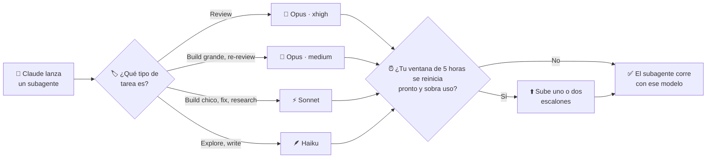

# jev-agent-router

[](LICENSE)


[English](README.md) · **Español**

Un [mod de Claude Code](https://code.claude.com/docs/en/plugins/mods/overview) que elige el
**modelo y el esfuerzo de cada subagente** según el tipo de tarea (review, build, fix,
explore…). Además los sube cuando a tu ventana de uso de 5 horas le falta poco para el reset y
todavía tiene margen. Nunca bloquea: con un clasificador prendido, un spawn espera como mucho `topeMs` (1 s por defecto).

```
router · ⬆️ subiendo un nivel hasta el reset (94m) · 3 de 4 subagentes reasignados · /router
```

*Esa es la línea de estado debajo del prompt. En el ejemplo, la ventana de 5 horas se reinicia en
94 minutos y sobra uso, así que los subagentes corren un escalón más arriba; 3 de 4 terminaron en
un modelo distinto del que pidió Claude.*

## Por qué

Cuando Claude orquesta subagentes, elige su modelo él mismo, y lo hace mal. En ~700 subagentes
reales de un mes de trabajo:

- 173 code reviews corrieron en Sonnet y solo 23 en Opus, aunque se le pedía "reviews en Opus".
- Las re-reviews corrieron en Haiku.
- La exploración del código heredaba Opus de la sesión principal.

El router le saca esa decisión al orquestador. Cada subagente recibe un modelo y un esfuerzo
acordes a su tarea, siempre igual, y ya no hace falta repetir "usá Opus para las reviews" en cada
sesión.

## Qué hace

| Tipo de tarea | Description de ejemplo | Corre en |
|---|---|---|
| `review-final` | "Final whole-branch review" | Opus · xhigh |
| `review` | "Review Task 3 (spec + quality)" | Opus · xhigh |
| `re-review` | "Re-review Task 6 fix round 2" | Opus · medium |
| `build-large` | "Implement Task 11: el compilador" | Opus · medium |
| `build-small` | "Implement Task 5b: fecha como marcador" | Sonnet · medium |
| `fix` | "Fix Task 3: hallazgos de la review" | Sonnet · high |
| `research` | "Research OIDC en Next 16" | Sonnet · medium |
| `write` | "Write the release notes" | Haiku · high |
| `explore` | "Explore el camino de ingesta" | Haiku · medium (techo Haiku · high) |

- **Primero las reglas.** El tipo sale de la `description` del subagente (verbos en castellano e
  inglés) y de su `subagent_type`. Las reglas resuelven solas la mayoría de los subagentes, con
  ~97% de acierto en un banco de 729 subagentes reales.
- **Un clasificador opcional para el resto.** Decide la talla de cada build y, cuando ninguna regla
  matchea, el tipo: [Jev](https://typesafe.ai) (el recomendado), Haiku, o una heurística de
  tamaño. Con Jev, además, revisa (y puede cambiar) el tipo de las reviews.
- **Una política de uso que solo sube.** Cerca del reset de la ventana de 5 horas, si sobra uso,
  cada subagente sube uno o dos escalones (⬆️ +1, 🔥 +2). Nunca baja ni bloquea nada.
- **Le enseña a Claude la convención de nombres.** El router la agrega a la descripción de la tool
  Agent, y le avisa a Claude cuando no reconoce una description.
- **Medición incluida.** `/router` abre un panel con las decisiones en curso, las métricas
  comparadas con tu propia línea base de antes del router, y el historial de decisiones.

## Requisitos

- **Claude Code 2.1.293 o posterior.** Los mods piden 2.1.287, pero el router además necesita que
  el alias `haiku` sea Haiku 5.5, que admite esfuerzo.
- Una suscripción de Claude o acceso por API que incluya Opus, Sonnet y Haiku.
- Opcional: una key de [Jev (TypeSafe AI)](https://typesafe.ai) para el clasificador.

## Instalación

> [!WARNING]
> Un mod corre código dentro de Claude Code con los permisos de tu usuario. Leé el código antes
> de instalarlo: los hooks están en [`router/hooks/register.tsx`](router/hooks/register.tsx).

**Desde el marketplace** (recomendado):

```bash
claude plugin marketplace add CiroVilmer/jev-agent-router
claude plugin install agent-router@jev-agent-router
```

O desde una sesión: `/plugin marketplace add CiroVilmer/jev-agent-router` y después
`/plugin install agent-router@jev-agent-router`. Si ya tenías una sesión abierta, corré `/reload-plugins`.

**Para una sola sesión, sin instalar:**

```bash
git clone https://github.com/CiroVilmer/jev-agent-router.git
claude --plugin-dir ./jev-agent-router/router
```

**Para comprobar que cargó:** corré `/router`. Se abre el panel, y la línea debajo del prompt
aparece en cuanto el router reasigna un subagente.

### Recomendado: agregá esto a tu `CLAUDE.md`

El router ya le explica a Claude cómo nombrar los subagentes, en la descripción de la tool
Agent. Pero una instrucción del `CLAUDE.md` de un proyecto o de tus prompts (por ejemplo "usá
subagentes Sonnet") puede pisarla. Para que gane la convención, sumá este bloque a
`~/.claude/CLAUDE.md` (todos los proyectos) o al `CLAUDE.md` de un proyecto:

```markdown
## Subagentes (mod router)

- No pases `model` en los subagentes: el router elige modelo y esfuerzo para cada uno. Solo si
  de verdad necesitás un modelo exacto, pasá `model` y poné `[pin]` en la description.
- Empezá cada `description` de subagente con el verbo de su tipo de tarea: Implement (construir
  o editar), Review (revisar sin editar), Re-review (volver a revisar un arreglo), Fix (arreglar
  hallazgos), Explore (leer o mapear código), Research (investigar fuera del repo), Write (notas
  o docs).
- Dentro de un plan, nombrá cada unidad `Task N` y repetí el mismo número en su build, su review
  y su fix: "Implement Task 3: parser", "Review Task 3: parser", "Fix Task 3: parser".
- Lanzá las reviews y verificaciones con el agente general-purpose, no con `Explore`: los
  subagentes `Explore` siempre cuentan como exploración y corren en Haiku.
- Lanzá en paralelo las tareas independientes y serializá las que tocan los mismos archivos,
  comparten estado o dependen del resultado de otra.
```

El router funciona sin esto. El bloque solo hace que Claude siga la convención con más
constancia, sobre todo cuando otras instrucciones le piden un modelo.

## Uso

| Comando | Qué hace |
|---|---|
| `/router` | Abre el panel con las pestañas **En curso**, **Métricas vs tu base** e **Historial** (teclas 1 a 3) |
| `/router off` · `/router on` | Apaga o prende el router en esta sesión |
| `/router permitir sonnet,opus` | Solo usa esos modelos en esta sesión |
| `/router fijar review opus·max` | Fija un tipo de tarea en un modelo y esfuerzo, por encima de la política |
| `/router reset` | Borra los overrides de la sesión |
| `/router historial [días]` | Exporta las decisiones de los últimos días (7 por defecto) a `~/.claude/router-historial.md` |
| `/router banco` | Corre el banco del clasificador, desde un clon de este repo (ver [el banco](docs/benchmark.md)) |
| `[pin]` en la description de un subagente | Respeta el modelo que pidió Claude |

Cada decisión queda registrada con sus motivos:

```
review      inherit → opus·xhigh    "Review Task 7: política de reintentos"  regla review · jev → review (0.98)
build-large inherit → opus·high     "Implement Task 8: guarda de cotización"  regla build · jev → build-large (1.00) · política +1
write       inherit → haiku·high    "Write Task 11: notas de la sesión"       regla write
```

## Configuración

Se cambia en `/config` → plugins → agent-router, o con `/plugin configure`.

| Opción | Default | Qué hace |
|---|---|---|
| `clasificador` | `reglas` | Quién decide cuando las reglas no alcanzan: `reglas` (heurística de tamaño, sin modelo), `haiku` o `jev` |
| `jevApiKey` | — | La key de Jev, guardada como dato sensible. Si falta, se usa la variable de entorno `JEV_API_KEY` |
| `jevUmbral` | `0.7` | Umbral de confianza de Jev: por debajo, el respaldo decide la talla de un build y en una review queda la regla |
| `topeMs` | `1000` | Tiempo máximo del clasificador. Si tarda más, decide el respaldo (50–8000) |
| `sombra` | `off` | Modo sombra: corre otro clasificador en segundo plano y guarda las dos respuestas para comparar |
| `fuegoMinutos` · `fuegoUsado` | `60` · `70` | 🔥 +2 escalones con 60 min o menos al reset y 70% de uso o menos |
| `sobraMinutos` · `sobraUsado` | `120` · `80` | ⬆️ +1 escalón con 120 min o menos al reset y 80% de uso o menos |
| `ensenarConvencion` | `true` | Si ninguna regla reconoce una description, Claude ve una línea con cómo nombrar en el resultado de Agent |
| `avisarAClaude` | `false` | Si el router reasigna un subagente, Claude ve el modelo elegido y el motivo |

Referencia completa (en inglés): [docs/configuration.md](docs/configuration.md).

### Privacidad

Con `clasificador: jev`, el router le manda a Jev **solo la description del subagente y un
resumen numérico de su prompt**: el largo, cuántos archivos y pasos nombra, y si menciona un
spec. Nunca le manda el prompt. Lo mismo vale para `sombra: jev` y para `/router banco`. Con `reglas`
o `haiku` y sin sombra de Jev, no sale nada de Claude Code.

## Cómo funciona



1. **Claude lanza un subagente** con una descripción corta, como "Review Task 3" o "Implement
   Task 5: parser".
2. **El router deduce el tipo de tarea** a partir de esa descripción. Cuando no está claro (por
   ejemplo, si un build es grande o chico), le pregunta a un clasificador como Jev.
3. **Elige el modelo y el esfuerzo** para ese tipo, según la tabla de arriba.
4. **Si tu ventana de uso está por reiniciarse y sobra uso**, sube uno o dos escalones, así el uso
   que ibas a perder se aprovecha en mejores modelos. Nunca baja.

El detalle técnico (reglas, clasificadores, la escalera completa), en inglés, está en
[docs/how-it-works.md](docs/how-it-works.md). La historia del diseño, en castellano, está en
[docs/](docs/README.md).

## Preguntas frecuentes

<details>
<summary><b>¿Funciona con API key o solo con suscripción?</b></summary>

Con las dos. Si no hay datos de la ventana de 5 horas (con API key, o antes de la primera
respuesta), la política queda neutra y se usa solo la tabla base.

</details>

<details>
<summary><b>¿Me va a gastar el uso?</b></summary>

La tabla base es lo que elegirías a mano. La política solo sube modelos cuando la ventana está
por reiniciarse con uso de sobra, que de otro modo perderías. Se apaga con `/router off`.

</details>

<details>
<summary><b>Claude igual pasa <code>model: sonnet</code>.</b></summary>

No importa: sin `[pin]`, el router lo reescribe. Para que Claude deje de hacerlo, sumá el
[bloque de CLAUDE.md](#recomendado-agregá-esto-a-tu-claudemd).

</details>

<details>
<summary><b>Una review corrió en Haiku.</b></summary>

Seguramente se lanzó con el tipo de subagente `Explore`, que siempre cuenta como exploración. El
bloque de CLAUDE.md le pide a Claude que use el agente general-purpose para las reviews.

</details>

<details>
<summary><b>¿Necesito Jev?</b></summary>

No. La opción por defecto (`reglas`) usa solo reglas y una heurística de tamaño. Jev suma un
clasificador calibrado para los casos que las reglas no pueden decidir.

</details>

## Estructura

```
router/            el mod (plugin): hooks, núcleo de decisión, UI y tests
bench/             banco offline: subagentes reales (anonimizados), etiquetas, scripts y corridas
docs/              cómo funciona, configuración, el banco; historia del diseño (en castellano)
.claude-plugin/    el manifiesto del marketplace
```

## Contribuir

Los issues y los pull requests son bienvenidos. En [CONTRIBUTING.md](CONTRIBUTING.md) está cómo
preparar el entorno, las reglas del cargador de mods y cómo correr los tests. El proyecto sigue el
[Contributor Covenant](CODE_OF_CONDUCT.md).

## Licencia

[MIT](LICENSE) © 2026 Ciro Vilmer

<sub>Proyecto independiente, sin relación ni aval de TypeSafe AI, los creadores de Jev. Jev es
opcional: el router funciona sin él.</sub>
