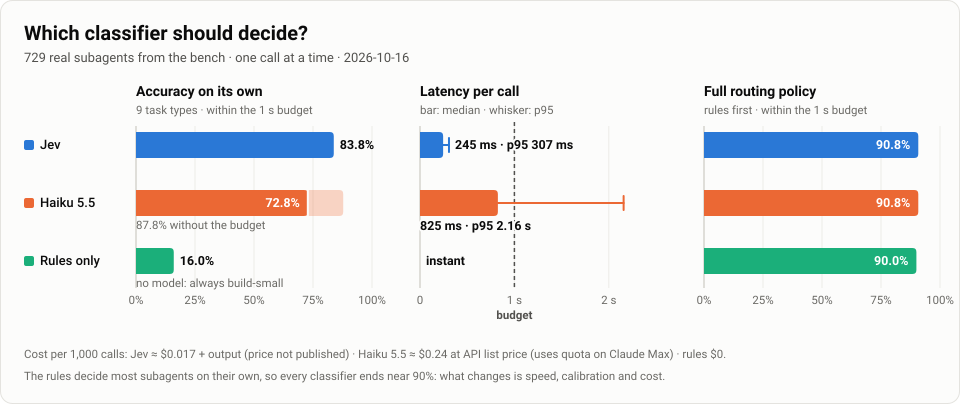
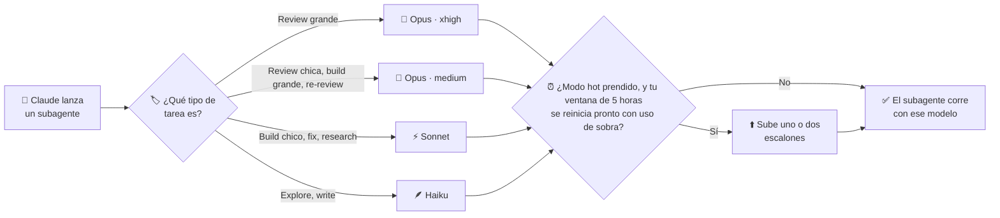

# jev-agent-router

[](LICENSE)


[English](README.md) · **Español**

Un [mod de Claude Code](https://code.claude.com/docs/en/plugins/mods/overview) que elige el
**modelo y el esfuerzo de cada subagente que Claude lanza mientras construye**, según el tipo de
tarea de cada uno: review, build, fix, explore… Ayuda a Claude a elegir bien entre modelos y
niveles de esfuerzo para cada tarea. Basta de reviews hechas con Sonnet o Haiku: empezá a routear
tus agentes de verdad.

**Pensado para subagent-driven development.** Cuando Claude avanza por un plan, implementando,
revisando y arreglando tarea tras tarea, cada rol recibe el modelo que le corresponde: reviews en
Opus con esfuerzo alto, builds según su tamaño, fixes e investigación en Sonnet, exploración y
notas en Haiku, que es rápido. Las reviews encuentran más, los builds van rápido, y tu uso se
gasta donde importa.

**Calidad y velocidad, no una u otra.** Cada tipo de tarea va al escalón donde mejor rinde, no
solo al modelo más fuerte. Los builds grandes corren en Opus con esfuerzo medium: código de nivel
Opus, y el thinking medium lo mantiene rápido; los chicos van a Sonnet. Las reviews grandes van a
Opus con esfuerzo xhigh, porque ahí pensar a fondo rinde; las del tamaño de una tarea corren en
Opus con esfuerzo medium, que es rápido y fuerte. La exploración corre en Haiku, porque leer
código no necesita un modelo más lento. La tabla por defecto se ajustó con un banco de ~700 subagentes reales, y podés cambiar cualquier
parte.

## Funciones

- **Lo configurás una vez.** Basta de repetir "usá Opus para las reviews" en cada sesión: decide
  el router, siempre.
- **Tu tabla, tus reglas.** Elegí el modelo y el esfuerzo de cada tipo de tarea en `/config`.
- **Reglas más un clasificador.** Reglas rápidas reconocen la mayoría de las tareas; el
  clasificador opcional [Jev](https://typesafe.ai) decide el resto, como el tamaño de un build.
- **Modo hot.** Si querés, el uso que ibas a perder antes del reset de tu ventana de 5 horas se
  gasta en modelos más fuertes.
- **No estorba.** Nunca bloquea un subagente; con un clasificador, un spawn espera 1 s como mucho.

## Por qué

Cuando Claude orquesta subagentes, elige su modelo él mismo, y lo hace mal.

### Un caso real

> Un mes de trabajo real (del 1 de septiembre al 2 de octubre de 2026): **698 subagentes**
> lanzados por Claude, aunque en cada sesión se le decía qué modelos usar ("Sonnet, y Opus para lo
> grande").

| Tarea | Lo que eligió Claude | Lo que hacía falta |
|---|---|---|
| Code reviews | **173 en Sonnet**, solo 23 en Opus | Opus |
| Re-reviews | **32 en Haiku** | Opus |
| Explorar el código | Heredaba **Opus** de la sesión principal | Haiku, que es más rápido |

El router le saca esa decisión al orquestador. Cada subagente recibe un modelo y un esfuerzo
acordes a su tarea, siempre igual, y ya no hace falta repetir "usá Opus para las reviews" en cada
sesión.

## Ruteo por tarea

| Tipo de tarea | Description de ejemplo | Corre en |
|---|---|---|
| `review-final` | "Final whole-branch review" | Opus · xhigh |
| `review-large` | "Review the payments feature" | Opus · xhigh |
| `review-small` | "Review Task 3 (spec + quality)" | Opus · medium |
| `re-review` | "Re-review Task 6 fix round 2" | Opus · medium |
| `build-large` | "Implement Task 11: el compilador" | Opus · medium |
| `build-small` | "Implement Task 5b: fecha como marcador" | Sonnet · medium |
| `fix` | "Fix Task 3: hallazgos de la review" | Sonnet · high |
| `research` | "Research OIDC en Next 16" | Sonnet · medium |
| `write` | "Write the release notes" | Haiku · high |
| `explore` | "Explore el camino de ingesta" | Haiku · medium (techo Haiku · high) |

- **Primero las reglas.** El tipo sale de la `description` del subagente (verbos en castellano e
  inglés) y de su `subagent_type`. Las reglas resuelven solas la mayoría de los subagentes, con
  ~97% de acierto en un banco de 729 subagentes reales.
- **Las reviews tienen talla.** Una review es grande o chica. El router mira, en este orden: un
  rango de tareas ("Tasks 3-5"); el build de la misma tarea; las palabras de alcance (feature,
  fase…), solo si la description no nombra una tarea numerada; y por último el clasificador, que si
  duda la deja chica. El detalle está en [cómo funciona](docs/how-it-works.md#review-size).
- **Un clasificador opcional para el resto.** Decide la talla de cada build y, cuando ninguna regla
  matchea, el tipo: [Jev](https://typesafe.ai) (el recomendado), Haiku, o una heurística de
  tamaño. Con Jev, además, revisa (y puede cambiar) el tipo de las reviews.
- **Modo hot opcional.** Se prende con `/router hot on`: cerca del reset de la ventana de 5 horas,
  si sobra uso, cada subagente sube uno o dos escalones (⬆️ +1, 🔥 +2). Nunca baja ni bloquea
  nada. Arranca apagado, y tu elección queda guardada.
- **Tu propia tabla.** Elegí el modelo y el esfuerzo de cada tipo de tarea en `/config`.
- **Le enseña a Claude la convención de nombres.** El router la agrega a la descripción de la tool
  Agent, y le avisa a Claude cuando no reconoce una description.
- **Medición incluida.** `/router` abre un panel con las decisiones en curso, las métricas
  comparadas con tu propia línea base de antes del router, y el historial de decisiones.

## Modelos

El router decide la mayoría de los subagentes con reglas. Para el resto (qué tan grande es un build
o una review, o una tarea que ninguna regla reconoce) consulta a un **clasificador**. Vos elegís
cuál: desde opciones en la nube hasta un modelo en tu propio hardware.

| `clasificador` | Dónde corre | Qué es |
|---|---|---|
| `jev` (recomendado) | Nube | [Jev](https://typesafe.ai), de TypeSafe AI: un clasificador dedicado con confianza calibrada. Necesita una API key |
| `haiku` | Nube | Claude Haiku 5.5, por tu sesión de Claude Code. Sin key extra: usa tu suscripción |
| `local` (experimental) | Tu máquina o tu servidor | Cualquier modelo self-hosted: decision models por la API System One ([llama.cpp](https://github.com/ggml-org/llama.cpp), [Ollama](https://ollama.com)), o un servidor compatible con OpenAI que devuelva logprobs |
| `reglas` (por defecto) | Ningún lado | Sin modelo: decide una heurística de tamaño |

Con `local`, nada sale del hardware que elijas, y podés elegir o ajustar el modelo vos mismo. Su
umbral todavía no está calibrado: ver la [configuración](docs/configuration.md#local-classifier-experimental).

### Cómo se comparan



En el [banco](docs/benchmark.md#comparing-selectors) de 729 subagentes reales, una llamada por vez:

| | Acierto solo | Dentro del tope de 1 s | Latencia mediana | Costo cada 1.000 llamadas |
|---|---|---|---|---|
| Jev | 83,8% | 83,8% | 245 ms | ≈ USD 0,017 + salida |
| Haiku 5.5 | 87,8% | 72,8% | 825 ms | ≈ USD 0,24 (cuota en Claude Max) |
| Solo reglas | 16,0% | 16,0% | instantáneo | USD 0 |

- **Jev es el más rápido y el único calibrado**: nunca pasó el tope de 1 s, y cuando dice 0,9 o
  más acierta el 95% de las veces.
- **Haiku 5.5 es el que más sabe, pero piensa antes de contestar**: un tercio de sus llamadas tarda
  más de un segundo, y dentro del tope queda al nivel de Jev.
- **Primero deciden las reglas**: resuelven solas la mayoría de los subagentes, y el clasificador
  solo se encarga del resto. Por eso la velocidad y la calibración importan tanto como el acierto.

## Requisitos

- **Claude Code 2.1.293 o posterior.** Los mods piden 2.1.287, pero el router además necesita que
  el alias `haiku` sea Haiku 5.5, que admite esfuerzo.
- Una suscripción de Claude o acceso por API que incluya Opus, Sonnet y Haiku.
- Opcional: una key de [Jev (TypeSafe AI)](https://typesafe.ai) para el clasificador.

## Instalación

> [!WARNING]
> Un mod corre código dentro de Claude Code con los permisos de tu usuario. Leé el código antes
> de instalarlo: los hooks están en [`router/hooks/register.tsx`](router/hooks/register.tsx).

**Desde el marketplace** (recomendado):

```bash
claude plugin marketplace add CiroVilmer/jev-agent-router
claude plugin install agent-router@jev-agent-router
```

O desde una sesión: `/plugin marketplace add CiroVilmer/jev-agent-router` y después
`/plugin install agent-router@jev-agent-router`. Si ya tenías una sesión abierta, corré `/reload-plugins`.

**Para una sola sesión, sin instalar:**

```bash
git clone https://github.com/CiroVilmer/jev-agent-router.git
claude --plugin-dir ./jev-agent-router/router
```

**Para comprobar que cargó:** corré `/router`. Se abre el panel, y la línea debajo del prompt
aparece con el primer subagente que decide el router.

### Recomendado: agregá esto a tu `CLAUDE.md`

El router ya le explica a Claude cómo nombrar los subagentes, en la descripción de la tool
Agent. Pero una instrucción del `CLAUDE.md` de un proyecto o de tus prompts (por ejemplo "usá
subagentes Sonnet") puede pisarla. Para que gane la convención, sumá este bloque a
`~/.claude/CLAUDE.md` (todos los proyectos) o al `CLAUDE.md` de un proyecto:

```markdown
## Subagentes (mod router)

- No pases `model` en los subagentes: el router elige modelo y esfuerzo para cada uno. Solo si
  de verdad necesitás un modelo exacto, pasá `model` y poné `[pin]` en la description.
- Empezá cada `description` de subagente con el verbo de su tipo de tarea: Implement (construir
  o editar), Review (revisar sin editar), Re-review (volver a revisar un arreglo), Fix (arreglar
  hallazgos), Explore (leer o mapear código), Research (investigar fuera del repo), Write (notas
  o docs).
- Dentro de un plan, nombrá cada unidad `Task N` y repetí el mismo número en su build, su review
  y su fix: "Implement Task 3: parser", "Review Task 3: parser", "Fix Task 3: parser".
- Lanzá las reviews y verificaciones con el agente general-purpose, no con `Explore`: los
  subagentes `Explore` siempre cuentan como exploración y corren en Haiku.
- Lanzá en paralelo las tareas independientes y serializá las que tocan los mismos archivos,
  comparten estado o dependen del resultado de otra.
```

El router funciona sin esto. El bloque solo hace que Claude siga la convención con más
constancia, sobre todo cuando otras instrucciones le piden un modelo.

## Uso

| Comando | Qué hace |
|---|---|
| `/router` | Abre el panel con las pestañas **En curso**, **Métricas vs tu base** e **Historial** (teclas 1 a 3) |
| `/router on` · `/router off` | Prende o apaga el router en esta sesión |
| `/router hot on` · `/router hot off` | Prende o apaga el modo hot, para esta sesión y las siguientes (apagado por defecto). `/router hot` dice cómo está |
| `/router allow sonnet,opus` | Solo usa esos modelos en esta sesión |
| `/router set review opus·max` | Fija un tipo de tarea en un modelo y esfuerzo para esta sesión, por encima de `/config` y de la política. `review` fija las dos tallas de review |
| `/router reset` | Borra el `allow` y el `set` de la sesión |
| `[pin]` en la description de un subagente | Respeta el modelo que pidió Claude |

Cada decisión queda registrada con sus motivos:

```
review-small inherit → opus·medium   "Review Task 7: política de reintentos"  regla review · jev → review (0.98) · talla del build de Tarea 7 (build-small)
build-large  inherit → opus·high     "Implement Task 8: guarda de cotización"  regla build · jev → build-large (1.00) · política +1
write        inherit → haiku·high    "Write Task 11: notas de la sesión"       regla write
```

La línea debajo del prompt muestra la última, por ejemplo
`router · Review Task 3: parser → opus·medium · regla`.

<details>
<summary><b>Más comandos</b>: exportar el historial y el banco del clasificador</summary>

| Comando | Qué hace |
|---|---|
| `/router history [días]` | Exporta las decisiones de los últimos días (7 por defecto) a `~/.claude/router-historial.md` |
| `/router bench` | Corre el banco del clasificador, desde un clon de este repo (ver [el banco](docs/benchmark.md)) |

</details>

## Configuración

Se cambia en `/config` → plugins → agent-router, o con `/plugin configure`.

| Opción | Default | Qué hace |
|---|---|---|
| `clasificador` | `reglas` | Quién decide cuando las reglas no alcanzan: `reglas` (heurística de tamaño, sin modelo), `haiku`, `jev` o `local` (experimental, tu propio servidor) |
| `jevApiKey` | — | La key de Jev, guardada como dato sensible. Si falta, se usa la variable de entorno `JEV_API_KEY` |
| `jevUmbral` | `0.7` | Umbral de confianza de Jev: por debajo, el respaldo decide la talla de un build, en una review queda la regla y la talla de una review es `review-small` |
| `topeMs` | `1000` | Tiempo máximo del clasificador. Si tarda más, decide el respaldo (50–8000) |
| `sombra` | `off` | Modo sombra: corre otro clasificador (`haiku`, `jev` o `local`) en segundo plano y guarda las dos respuestas para comparar |
| `localProtocolo` · `localUrl` · `localModelo` · `localApiKey` · `localUmbral` | `systemone` · — · — · — · `0.7` | El clasificador `local`, experimental: protocolo (`systemone` u `openai`), endpoint, modelo, key opcional y umbral de confianza (sin calibrar). Ver [docs/configuration.md](docs/configuration.md#local-classifier-experimental) |
| `fuegoMinutos` · `fuegoUsado` | `60` · `70` | 🔥 +2 escalones con 60 min o menos al reset y 70% de uso o menos |
| `sobraMinutos` · `sobraUsado` | `120` · `80` | ⬆️ +1 escalón con 120 min o menos al reset y 80% de uso o menos |
| `ensenarConvencion` | `true` | Si ninguna regla reconoce una description, Claude ve una línea con cómo nombrar en el resultado de Agent |
| `avisarAClaude` | `false` | Si el router reasigna un subagente, Claude ve el modelo elegido y el motivo |

**Modelo por tipo de tarea.** Cada tipo tiene su opción (`modeloReviewLarge`, `modeloReviewSmall`,
`modeloReReview`, `modeloReviewFinal`, `modeloBuildLarge`, `modeloBuildSmall`, `modeloFix`, `modeloExplore`,
`modeloResearch`, `modeloWrite`). Elegí cualquier escalón de `haiku·low` a `opus·xhigh`, o dejá
`por defecto` para usar la tabla del router. Con el modo hot prendido, la política sube desde lo
que elegiste. `modeloReview` es legado: aplica a las dos tallas de review si no las elegís por
separado.

Referencia completa (en inglés): [docs/configuration.md](docs/configuration.md).

### Privacidad

Con `clasificador: jev`, el router le manda a Jev **solo la description del subagente y un
resumen numérico de su prompt**: el largo, cuántos archivos y pasos nombra, y si menciona un
spec. Nunca le manda el prompt. Lo mismo vale para `sombra: jev` y para `/router bench`. Con `reglas`
o `haiku` y sin sombra de Jev ni local, no sale nada de Claude Code. Con `clasificador: local` o
`sombra: local`, esa misma description y ese resumen numérico van a la `localUrl` que configuraste,
que puede ser un servidor remoto.

## Cómo funciona



1. **Claude lanza un subagente** con una descripción corta, como "Review Task 3" o "Implement
   Task 5: parser".
2. **El router deduce el tipo de tarea** a partir de esa descripción. Cuando no está claro (por
   ejemplo, si un build es grande o chico), le pregunta a un clasificador como Jev.
3. **Elige el modelo y el esfuerzo** para ese tipo, según la tabla de arriba o lo que elegiste
   en `/config`.
4. **Con el modo hot prendido, si tu ventana de uso está por reiniciarse y sobra uso**, sube uno o
   dos escalones, así el uso que ibas a perder se aprovecha en mejores modelos. Nunca baja. El modo
   hot está apagado hasta que corrés `/router hot on`.

El detalle técnico (reglas, clasificadores, la escalera completa), en inglés, está en
[docs/how-it-works.md](docs/how-it-works.md). La historia del diseño, en castellano, está en
[docs/](docs/README.md).

## Preguntas frecuentes

<details>
<summary><b>¿Funciona con API key o solo con suscripción?</b></summary>

Con las dos. Si no hay datos de la ventana de 5 horas (con API key, o antes de la primera
respuesta), la política queda neutra y se usa solo la tabla base.

</details>

<details>
<summary><b>¿Me va a gastar el uso?</b></summary>

La tabla base es lo que elegirías a mano. La política solo sube modelos cuando la ventana está
por reiniciarse con uso de sobra, y solo con el modo hot prendido (`/router hot on`); viene
apagado.

</details>

<details>
<summary><b>Claude igual pasa <code>model: sonnet</code>.</b></summary>

No importa: sin `[pin]`, el router lo reescribe. Para que Claude deje de hacerlo, sumá el
[bloque de CLAUDE.md](#recomendado-agregá-esto-a-tu-claudemd).

</details>

<details>
<summary><b>Una review corrió en Haiku.</b></summary>

Seguramente se lanzó con el tipo de subagente `Explore`, que siempre cuenta como exploración. El
bloque de CLAUDE.md le pide a Claude que use el agente general-purpose para las reviews.

</details>

<details>
<summary><b>¿Necesito Jev?</b></summary>

No. La opción por defecto (`reglas`) usa solo reglas y una heurística de tamaño. Jev suma un
clasificador calibrado para los casos que las reglas no pueden decidir.

</details>

## Estructura

```
router/            el mod (plugin): hooks, núcleo de decisión, UI y tests
bench/             banco offline: subagentes reales (anonimizados), etiquetas, scripts y corridas
docs/              cómo funciona, configuración, el banco; historia del diseño (en castellano)
.claude-plugin/    el manifiesto del marketplace
```

## Contribuir

Los issues y los pull requests son bienvenidos. En [CONTRIBUTING.md](CONTRIBUTING.md) está cómo
preparar el entorno, las reglas del cargador de mods y cómo correr los tests. El proyecto sigue el
[Contributor Covenant](CODE_OF_CONDUCT.md).

## Licencia

[MIT](LICENSE) © 2026 Ciro Vilmer

<sub>Proyecto independiente, sin relación ni aval de TypeSafe AI, los creadores de Jev. Jev es
opcional: el router funciona sin él.</sub>
