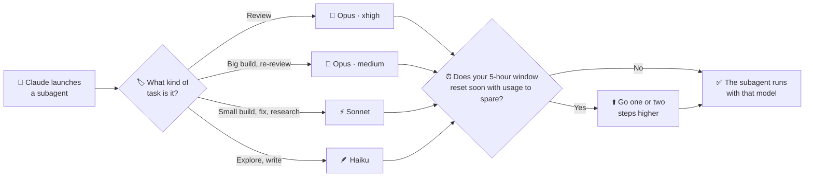

# jev-agent-router

[](LICENSE)


**English** · [Español](README.es.md)

A [Claude Code mod](https://code.claude.com/docs/en/plugins/mods/overview) that picks the
**model and effort of every subagent** from the kind of task it does (review, build, fix,
explore…), and raises them when your 5-hour usage window is about to reset with room to spare.
It never blocks: with a classifier enabled, a spawn waits at most `topeMs` (1 s by default).

```
router · Review Task 3: parser → opus·xhigh · jev 0.98
```

*The line below the prompt shows the router's latest decision: which subagent, the model and effort
it got, and who decided (here, Jev with 0.98 confidence). A trailing `+1` or `+2` means the usage
policy raised it.*

## Why

When Claude orchestrates subagents, it chooses their model itself, and it is not good at it.
In ~700 real subagents from one month of work:

- 173 code reviews ran on Sonnet and only 23 on Opus, even when told "reviews on Opus".
- Re-reviews ran on Haiku.
- Codebase exploration inherited Opus from the parent session.

The router takes that decision away from the orchestrator. Every subagent gets a model and an
effort level that fit its task, the same way every time, so you don't have to repeat "use Opus
for reviews" in every session.

## What it does

| Task type | Example description | Runs on |
|---|---|---|
| `review-final` | "Final whole-branch review" | Opus · xhigh |
| `review` | "Review Task 3 (spec + quality)" | Opus · xhigh |
| `re-review` | "Re-review Task 6 fix round 2" | Opus · medium |
| `build-large` | "Implement Task 11: the compiler" | Opus · medium |
| `build-small` | "Implement Task 5b: date marker" | Sonnet · medium |
| `fix` | "Fix Task 3: review findings" | Sonnet · high |
| `research` | "Research OIDC in Next 16" | Sonnet · medium |
| `write` | "Write the release notes" | Haiku · high |
| `explore` | "Explore the ingest path" | Haiku · medium (max Haiku · high) |

- **Rules first.** The task type comes from the subagent's `description` (English and Spanish
  verbs) and `subagent_type`. Rules resolve most subagents on their own, with ~97% accuracy on a
  bench of 729 real subagents.
- **An optional classifier for the rest.** For every build it picks the size, and when no rule
  matches it picks the type: [Jev](https://typesafe.ai) (recommended), Haiku, or a size heuristic.
  With Jev, it also re-checks (and may change) the type of reviews.
- **Usage policy that only goes up.** Close to the reset of your 5-hour window, with usage to
  spare, every subagent climbs one or two steps up the ladder (⬆️ +1, 🔥 +2). It never lowers
  anything and never blocks.
- **It teaches Claude the naming convention.** The router adds the convention to the Agent tool's
  description, and tells Claude when a description wasn't recognized.
- **Measurement built in.** `/router` opens a panel with live decisions, metrics against your own
  pre-router baseline, and the decision history.

## Requirements

- **Claude Code 2.1.293 or later.** Mods need 2.1.287, and the router relies on the `haiku` alias
  resolving to Haiku 5.5, which supports effort levels.
- A Claude subscription or API access that includes Opus, Sonnet and Haiku.
- Optional: a [Jev (TypeSafe AI)](https://typesafe.ai) API key for the classifier.

## Installation

> [!WARNING]
> A mod runs code inside Claude Code with your user's permissions. Read the source before
> installing it: the hooks live in [`router/hooks/register.tsx`](router/hooks/register.tsx).

**From the marketplace** (recommended):

```bash
claude plugin marketplace add CiroVilmer/jev-agent-router
claude plugin install agent-router@jev-agent-router
```

Or from inside a session: `/plugin marketplace add CiroVilmer/jev-agent-router`, then
`/plugin install agent-router@jev-agent-router`. If a session was already open, run `/reload-plugins`.

**For a single session, without installing:**

```bash
git clone https://github.com/CiroVilmer/jev-agent-router.git
claude --plugin-dir ./jev-agent-router/router
```

**Check that it loaded:** run `/router`. The panel opens, and the line below the prompt appears
with the first subagent the router decides.

### Recommended: add this to your `CLAUDE.md`

The router already tells Claude how to name subagents, in the Agent tool's description. But
instructions in a project's `CLAUDE.md` or in your prompts (for example "use Sonnet subagents")
can override it. Add this block to `~/.claude/CLAUDE.md` (all projects) or to a project's
`CLAUDE.md`, so the convention wins:

```markdown
## Subagents (router mod)

- Don't set `model` on subagents: the router picks model and effort for each one. Only if you
  truly need a specific model, pass `model` and put `[pin]` in the description.
- Start every subagent `description` with the verb of its task type: Implement (build or edit),
  Review (check without editing), Re-review (review a fix again), Fix (address findings),
  Explore (read or map code), Research (look things up outside the repo), Write (notes or docs).
- Inside a plan, name each unit `Task N` and reuse the same number for its build, review and
  fix: "Implement Task 3: parser", "Review Task 3: parser", "Fix Task 3: parser".
- Launch reviews and verifications with the general-purpose agent, not `Explore`: `Explore`
  subagents always run as exploration, on Haiku.
- Run independent tasks in parallel; serialize the ones that touch the same files, share state,
  or depend on each other's results.
```

The router works without it. The block only makes Claude follow the convention more reliably,
especially when other instructions ask for a specific model.

## Usage

| Command | What it does |
|---|---|
| `/router` | Opens the panel: **En curso** (live), **Métricas vs tu base** (metrics vs your baseline) and **Historial** (history) tabs, keys 1–3 |
| `/router off` · `/router on` | Turns the router off or on for this session |
| `/router permitir sonnet,opus` | Only use these models in this session |
| `/router fijar review opus·max` | Pin a task type to a model and effort, above the policy |
| `/router reset` | Clears this session's overrides |
| `/router historial [days]` | Exports the last days of decisions (7 by default) to `~/.claude/router-historial.md` |
| `/router banco` | Runs the classifier bench, from a clone of this repo (see [the bench](docs/benchmark.md)) |
| `[pin]` in a subagent's description | Keeps the model Claude asked for |

Every decision is recorded with its reasons:

```
review      inherit → opus·xhigh    "Review Task 7: retry policy"      regla review · jev → review (0.98)
build-large inherit → opus·high     "Implement Task 8: quote guard"    regla build · jev → build-large (1.00) · política +1
write       inherit → haiku·high    "Write Task 11: session notes"     regla write
```

> [!NOTE]
> The router's commands, panel and messages are in **Spanish** (`permitir`, `fijar`,
> `historial`, motives like `regla review`). The documentation explains each one in English.

## Configuration

Change these in `/config` → plugins → agent-router, or with `/plugin configure`.

| Option | Default | What it does |
|---|---|---|
| `clasificador` | `reglas` | Who decides when rules aren't enough: `reglas` (size heuristic, no model), `haiku`, or `jev` |
| `jevApiKey` | — | Jev key, stored as sensitive. Falls back to the `JEV_API_KEY` environment variable |
| `jevUmbral` | `0.7` | Jev's confidence threshold: below it, the fallback decides a build's size and the rule keeps a review |
| `topeMs` | `1000` | Classifier time budget. If it takes longer, the fallback decides (50–8000) |
| `sombra` | `off` | Shadow mode: runs another classifier in the background and stores both answers to compare |
| `fuegoMinutos` · `fuegoUsado` | `60` · `70` | 🔥 +2 steps when ≤ 60 min to the reset and ≤ 70% used |
| `sobraMinutos` · `sobraUsado` | `120` · `80` | ⬆️ +1 step when ≤ 120 min to the reset and ≤ 80% used |
| `ensenarConvencion` | `true` | When no rule recognizes a description, Claude sees a one-line hint in the Agent result |
| `avisarAClaude` | `false` | When the router reassigns a subagent, Claude sees the chosen model and why |

Full reference: [docs/configuration.md](docs/configuration.md).

### Privacy

With `clasificador: jev`, the router sends Jev **only the subagent's description and a numeric
summary of its prompt** (length, number of files and steps it names, whether it mentions a spec).
It never sends the prompt. The same applies to `sombra: jev` and to `/router banco`. With
`reglas` or `haiku` and no Jev shadow, nothing leaves Claude Code.

## How it works



1. **Claude launches a subagent** with a short description, like "Review Task 3" or "Implement
   Task 5: parser".
2. **The router figures out the task type** from that description. When it isn't clear (for
   example, whether a build is big or small), it asks a classifier such as Jev.
3. **It picks the model and effort** for that type from the table above.
4. **If your usage window is about to reset with usage left over**, it goes one or two steps
   higher, so the usage you'd lose is spent on better models. It never goes lower.

The technical details (rules, classifiers, the full ladder) are in
[docs/how-it-works.md](docs/how-it-works.md). The design history, in Spanish, is in
[docs/](docs/README.md).

## FAQ

<details>
<summary><b>Does it work with API keys, or only with a subscription?</b></summary>

Both. Without 5-hour window data (API key, or before the first response), the policy stays
neutral and only the base table applies.

</details>

<details>
<summary><b>Will it burn my usage?</b></summary>

The base table is what you'd pick by hand. The policy only raises models when your window
resets soon with usage left over, which you'd lose otherwise. Turn it off with `/router off`.

</details>

<details>
<summary><b>Claude still passes <code>model: sonnet</code>.</b></summary>

It doesn't matter: without `[pin]` the router overrides it. To make Claude stop, add the
[CLAUDE.md block](#recommended-add-this-to-your-claudemd).

</details>

<details>
<summary><b>A review ran on Haiku.</b></summary>

It was probably launched with the `Explore` subagent type, which always counts as exploration.
The CLAUDE.md block asks Claude to use the general-purpose agent for reviews.

</details>

<details>
<summary><b>Do I need Jev?</b></summary>

No. The default (`reglas`) uses only rules and a size heuristic. Jev adds a calibrated
classifier for the cases rules can't decide.

</details>

## Project layout

```
router/            the mod (plugin): hooks, decision core, UI, tests
bench/             offline bench: real subagents (anonymized), labels, scripts, runs
docs/              how it works, configuration, bench; design history (Spanish)
.claude-plugin/    marketplace manifest
```

## Contributing

Issues and pull requests are welcome. See [CONTRIBUTING.md](CONTRIBUTING.md) for the dev setup,
the mod loader's rules and how to run the tests. This project follows the
[Contributor Covenant](CODE_OF_CONDUCT.md).

## License

[MIT](LICENSE) © 2026 Ciro Vilmer

<sub>Independent project, not affiliated with or endorsed by TypeSafe AI, the makers of Jev. Jev is
optional: the router works without it.</sub>
